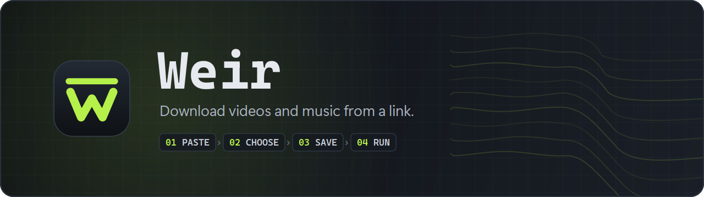
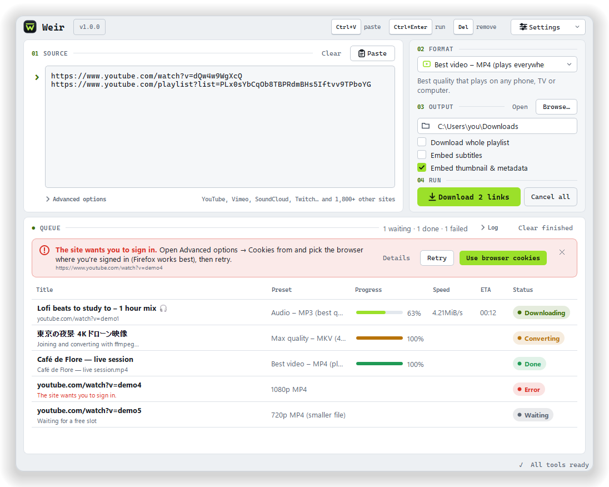

<p align="center">
  
</p>

<p align="center">
  <b>A clean desktop app for downloading videos and music.</b><br>
  Paste a link, pick what you want, click Download. No terminal, no fuss.
</p>

<p align="center">
  <a href="https://github.com/Zoryc/Weir/releases/latest"></a>
  <a href="https://github.com/Zoryc/Weir/releases"></a>
  <a href="https://github.com/Zoryc/Weir/actions/workflows/ci.yml"></a>
  
  <a href="LICENSE"></a>
</p>

<p align="center">
  <a href="https://github.com/Zoryc/Weir/releases/latest"></a>
  &nbsp;
  <a href="https://github.com/Zoryc/Weir/releases/latest"></a>
</p>

<br>

<picture>
  <source media="(prefers-color-scheme: dark)" srcset="docs/weir-dark.png">
  
</picture>

## Why Weir

Weir puts [yt-dlp](https://github.com/yt-dlp/yt-dlp), the most capable video downloader there
is, behind one calm window. It works with YouTube, Vimeo, SoundCloud, Twitch and
[1,800+ other sites](https://github.com/yt-dlp/yt-dlp/blob/master/supportedsites.md).

<table>
  <tr>
    <td width="50%" valign="top">
      <h4>📋 Paste and go</h4>
      Paste one link or fifty, or drag them straight from your browser. Playlists work too.
    </td>
    <td width="50%" valign="top">
      <h4>🎚️ Formats in plain words</h4>
      "Best video, plays everywhere", "MP3", "1080p"… each preset says what you'll get.
    </td>
  </tr>
  <tr>
    <td valign="top">
      <h4>⚡ Several at once</h4>
      Up to three downloads in parallel, with progress, speed and time left for each.
    </td>
    <td valign="top">
      <h4>🩺 Errors you can fix</h4>
      Instead of a wall of text: what went wrong and a button that fixes it.
    </td>
  </tr>
  <tr>
    <td valign="top">
      <h4>🧰 Sets itself up</h4>
      On first start, Weir fetches yt-dlp, ffmpeg and Deno in one click and checks every file.
    </td>
    <td valign="top">
      <h4>🌗 Light and dark</h4>
      Follows your system theme on Windows and Linux, and tells you when the queue is done.
    </td>
  </tr>
</table>

## How it works

The window is laid out as four numbered steps:

| | Step | What you do |
|:---:|---|---|
| `01` | **Source** | Paste links into the box (or drag them in). |
| `02` | **Format** | Pick a preset. The line under it explains what you'll get. |
| `03` | **Output** | Choose the folder, and whether you want the whole playlist, subtitles or cover art. |
| `04` | **Run** | Click **Download**. Watch the queue fill up below. |

Right-click a download to open the file or its folder, retry it, or copy an error to ask for help.

### Presets

| Preset | You get |
|---|---|
| **Best video – MP4** | The best quality that plays on any phone, TV or computer. |
| **1080p MP4** | Full HD video (H.264 + AAC), very compatible. |
| **720p MP4** | HD at roughly half the size of 1080p. |
| **Max quality – MKV** | The highest resolution available, 4K and above. Best played on a computer, e.g. with VLC. |
| **Audio – MP3** | Sound only, as an MP3 that plays everywhere. |
| **Audio – original** | Sound only, in the site's original format, with no quality loss. |

Want something else? **Advanced options → Save current settings as a new preset**.

## Install

Grab the latest files from the **[Releases page](https://github.com/Zoryc/Weir/releases/latest)**.

### Windows 10 / 11

Download `Weir-Setup-<version>.exe` and run it. Weir installs for your account only, so no
administrator password is needed. It adds itself to the Start menu (and, if you like, the
desktop), and can be removed from *Settings → Apps*. The installer speaks English and French.

> [!NOTE]
> The installer isn't code-signed yet, so Windows may show *"Windows protected your PC"*.
> Click **More info → Run anyway**.

### Linux

Download `Weir-<version>-x86_64.AppImage`, make it executable (right-click → Properties →
*Allow executing as program*) and double-click it. Nothing else to install.

> [!TIP]
> If it doesn't start, your system may need FUSE 2: `sudo apt install libfuse2` on
> Debian/Ubuntu, `sudo dnf install fuse-libs` on Fedora.

On first start, Weir offers to download the free tools it uses. One click and you're ready.

## Troubleshooting

<details>
<summary><b>"Sign in to confirm you're not a bot", or an age-restricted video</b></summary>
<br>

Click **Use browser cookies** in the error message (or open **Advanced options → Cookies from**)
and pick the browser where you're signed in to the site, then click **Retry** on the download.
The list only shows the browsers Weir finds on your computer.

- **Firefox works best**, on Windows and Linux. Sign in to the site in Firefox first. If
  Firefox isn't in the list, it isn't installed or hasn't been started yet.
- **On Windows, Chrome, Edge and Brave** keep their cookies locked away from other apps, so
  Weir usually can't use them there, even with the browser closed. Use Firefox or a cookies.txt
  file instead.
- **cookies.txt file…** uses a cookies.txt file exported from your browser while you're signed
  in to the site. yt-dlp's FAQ, [How do I pass cookies to yt-dlp?](https://github.com/yt-dlp/yt-dlp/wiki/FAQ#how-do-i-pass-cookies-to-yt-dlp),
  names add-ons that do this: *Get cookies.txt LOCALLY* for Chrome and Edge, *cookies.txt* for
  Firefox. Avoid look-alikes: an older Chrome add-on called just "Get cookies.txt" was reported
  as malware and removed from the Chrome Web Store. Export a fresh file if it stops working.

> [!WARNING]
> A cookies.txt file lets anyone who has it use your account on that site. Keep it to
> yourself, and delete it when you no longer need it.
</details>

<details>
<summary><b>"This video isn't available in the format this preset asks for"</b></summary>
<br>

Click **Choose another preset** in the error message, pick e.g. *Best video – MP4*, and
download again.
</details>

<details>
<summary><b>A YouTube video won't download at all</b></summary>
<br>

YouTube changes often. Open **Settings → Update yt-dlp**, then retry. If Weir says Deno is
missing, let it download Deno: yt-dlp needs it for YouTube.
</details>

<details>
<summary><b>Where are my settings and the downloaded tools?</b></summary>
<br>

| | Windows | Linux |
|---|---|---|
| Settings | `%LOCALAPPDATA%\Weir\settings.json` | `~/.config/Weir/settings.json` |
| Tools | `bin\` next to Weir.exe | `~/.local/share/Weir/bin` |

**Settings → Open settings folder** and **Open tools folder** take you there. Unexpected
errors are logged to `error.log` in the settings folder.
</details>

## For developers

<details>
<summary><b>Run from source</b></summary>
<br>

You need Python 3.11 or newer.

```bash
python -m venv .venv
.venv/bin/python -m pip install -r requirements.txt      # Windows: .venv\Scripts\python
.venv/bin/python main.py
```

On Linux with X11, Qt 6 needs `libxcb-cursor0` (Fedora: `xcb-util-cursor`). Links can also be
passed on the command line: `python main.py https://…`.

When running from source with the Microsoft Store version of Python, Windows redirects the
settings folder to `%LOCALAPPDATA%\Packages\PythonSoftwareFoundation.Python.3.x_…\LocalCache\Local\Weir`.
</details>

<details>
<summary><b>Build the installer and the AppImage</b></summary>
<br>

| | Command | Result |
|---|---|---|
| Windows installer | `build_installer.bat` (needs [Inno Setup 6](https://jrsoftware.org/isdl.php)) | `dist\Weir-Setup-<version>.exe` |
| Windows app folder | `build_windows.bat` | `dist\Weir\Weir.exe` |
| Linux AppImage | `./build_linux.sh` | `dist/Weir-<version>-<arch>.AppImage` |

Each script creates a virtual environment, installs PyInstaller, draws the logo and builds.
Add `--with-bin` to `build_windows.bat` or `build_linux.sh` to bundle your local `bin/` tools.
Build the AppImage on the oldest distribution you want to support (glibc).
</details>

<details>
<summary><b>Make a release</b></summary>
<br>

1. Set `APP_VERSION` in `core/__init__.py` and add a `## <version> — <date>` section to
   [`CHANGELOG.md`](CHANGELOG.md).
2. Commit, tag and push: `git tag v<version>` then `git push origin main v<version>`.

The [Release workflow](.github/workflows/release.yml) builds the Windows installer and the Linux
AppImage on GitHub and publishes them, using the changelog section as release notes.
</details>

<details>
<summary><b>Check the UI</b></summary>
<br>

```bash
python tools/screenshots.py --check      # light/dark screenshots + automatic layout checks
python tools/readme_art.py               # redraw docs/banner.png and docs/logo.png
```
</details>

<details>
<summary><b>Project layout</b></summary>
<br>

```
main.py               entry point: app setup, theme, window
ui/design.py          Weir's design: colours, metrics, stylesheet and layout
ui/main_window.py     the main window: creates the controls and does all the work
ui/theme.py           design system: Theme/Metrics/Design, base stylesheet, light/dark
ui/dialogs.py         tools wizard, yt-dlp updater, error details, About
ui/widgets.py         link box, toggles, advanced panel, list cells, error banner
ui/icon.py            logo and glyphs, drawn in code (also icon.ico and installer art)
ui/kit.py             small layout helpers
core/downloader.py    queue, QProcess handling, output parsing, cancel + cleanup
core/deps.py          finding, checking and downloading yt-dlp, ffmpeg and Deno
core/presets.py       preset loading/saving and argument parsing
core/errors.py        raw yt-dlp output → friendly message + fix
core/browsers.py      which browsers are installed, for reading cookies
core/process.py       child-process environment, process-tree kill
core/settings.py      settings JSON
core/paths.py         app, config and tool folders
presets.json          built-in presets
installer/weir.iss    Inno Setup script for the Windows installer
tools/                screenshots + layout checks, README art
```

Weir runs the official yt-dlp binary as a separate program (it doesn't import the Python
package), always with `--ignore-config`. Downloaded tools are verified against the SHA-256
checksums published with each release.
</details>

## Credits & license

Weir is built on [yt-dlp](https://github.com/yt-dlp/yt-dlp), [FFmpeg](https://ffmpeg.org)
([yt-dlp builds](https://github.com/yt-dlp/FFmpeg-Builds)), [Deno](https://deno.com) and
[Qt for Python](https://doc.qt.io/qtforpython-6/). It downloads and runs those tools separately,
under their own licenses (Unlicense, GPL, MIT); the app bundles PySide6 (LGPL).

Weir itself is released under the [MIT License](LICENSE).

<p align="center"><sub>Please only download content you have the right to download.</sub></p>
