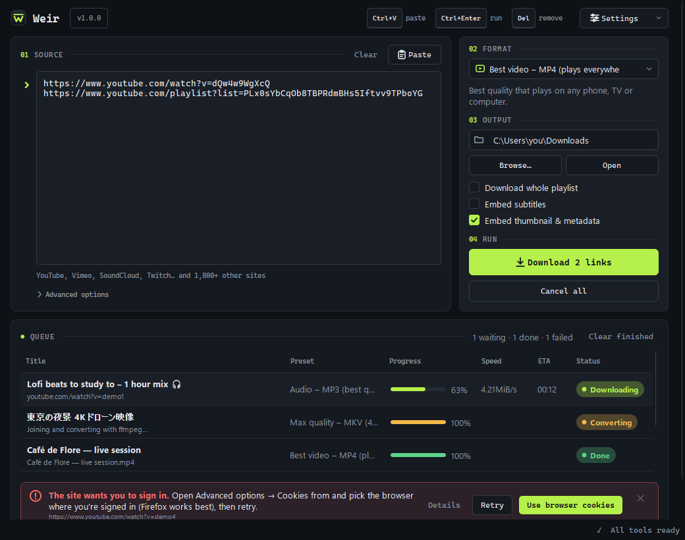

# Weir

A video and music downloader for Windows 10/11 and Linux (X11 and Wayland), built on
[yt-dlp](https://github.com/yt-dlp/yt-dlp). Paste a link, pick a preset, click **Download**.
No terminal needed.

**[Download the latest version](https://github.com/Zoryc/Weir/releases/latest)**



- One screen, laid out as numbered steps: **01 Source** (paste or drag & drop links),
  **02 Format**, **03 Output**, **04 Run**, with the download queue underneath.
- First-run wizard downloads the tools it needs (yt-dlp, ffmpeg + ffprobe, Deno) with one click.
- Up to 3 downloads at once, with progress, speed, ETA and status for each.
- Plain-language error messages with a one-click fix (use browser cookies, pick another preset,
  download Deno or ffmpeg, update yt-dlp).
- Light and dark mode, following the system setting; a notification when the queue finishes.

## Install

Get the files from the [Releases page](https://github.com/Zoryc/Weir/releases/latest).

**Windows:** run `Weir-Setup-<version>.exe`. It installs for your user account only (no
administrator password), adds Weir to the Start menu (and optionally the desktop) and
appears in *Settings → Apps* for uninstalling. The setup is in English or French depending
on your system. The installer isn't code-signed yet, so Windows may show *"Windows protected
your PC"*: click **More info → Run anyway**.

**Linux:** download `Weir-<version>-x86_64.AppImage`, make it executable (right-click →
Properties → *Allow executing as program*, or `chmod +x Weir-*.AppImage`) and double-click
it. Nothing else to install. If it doesn't start, your system may need FUSE 2
(`sudo apt install libfuse2` on Debian/Ubuntu).

## Run from source

You need Python 3.11 or newer.

**Windows** (PowerShell or cmd):

```bat
python -m venv .venv
.venv\Scripts\python -m pip install -r requirements.txt
.venv\Scripts\pythonw main.py
```

**Linux**:

```bash
python3 -m venv .venv
.venv/bin/python -m pip install -r requirements.txt
.venv/bin/python main.py
```

On X11, Qt 6 needs `libxcb-cursor0` (Debian/Ubuntu: `sudo apt install libxcb-cursor0`,
Fedora: `sudo dnf install xcb-util-cursor`). Wayland works out of the box; to force X11 run with
`QT_QPA_PLATFORM=xcb`.

You can also pass links on the command line: `python main.py https://…`.

## Build

Each script creates a virtual environment, installs the requirements and PyInstaller, draws
the logo, and builds the app.

**Windows installer** (needs [Inno Setup 6](https://jrsoftware.org/isdl.php), free; or
`winget install --id JRSoftware.InnoSetup -e`):

```bat
build_installer.bat
```

→ `dist\Weir-Setup-<version>.exe`. To build only the app folder (`dist\Weir\Weir.exe`), run
`build_windows.bat`.

**Linux AppImage:**

```bash
./build_linux.sh
```

→ `dist/Weir-<version>-<arch>.AppImage` (the script downloads `appimagetool` the first time).
Build on the oldest distribution you want to support, since PyInstaller ties the build to
that system's glibc.

Add `--with-bin` to `build_windows.bat` or `build_linux.sh` to also bundle your local `bin/`
folder (already-downloaded yt-dlp, ffmpeg, Deno) so the build works offline from the first
start. The installer always leaves the tools out; Weir downloads them on first start.

## The tools

| Tool | Why | Source |
|------|-----|--------|
| yt-dlp | the downloader | official standalone binary from `github.com/yt-dlp/yt-dlp` releases (`yt-dlp.exe` / `yt-dlp_linux`) |
| ffmpeg + ffprobe | merging, converting, embedding | GPL builds from `github.com/yt-dlp/FFmpeg-Builds` (win64 / linux64) |
| Deno | JavaScript runtime yt-dlp needs for full YouTube support | latest release from `github.com/denoland/deno` |

Weir looks in its own `bin/` folder first, then on the system `PATH` (a system ffmpeg on
Linux is fine). When the app folder isn't writable (the AppImage, or an install under
Program Files), tools go to `%LOCALAPPDATA%\Weir\bin` or `~/.local/share/Weir/bin` instead.
Downloads are checked against the SHA-256 checksums published with each release.

**Settings → Update yt-dlp** runs `yt-dlp -U` and shows its output. **Settings → Tools**
shows what's installed and can re-download any tool. **Settings → About** shows all three
versions. The line at the bottom right of the window says whether every tool is ready.

Weir calls the yt-dlp binary as a separate program (it does not import the Python package),
always with `--ignore-config`, so a personal yt-dlp config file can't change its behaviour. To
use one anyway, add `--config-locations <path>` under Advanced options → Extra options.

## Presets

Built-in presets live in `presets.json` next to the program. Each has a `name`, a one-line
`description` shown under the dropdown, and `args` (yt-dlp options written like on a command
line):

```json
{ "name": "720p MP4 (smaller file)",
  "description": "HD video at roughly half the size of 1080p.",
  "args": "-S \"res:720,vcodec:h264,acodec:aac\" --merge-output-format mp4 --remux-video mp4" }
```

**Advanced options → Save current settings as a new preset** stores the selected preset's
options plus your extra options, playlist/subtitle/thumbnail choices, file-name template and
speed limit as your own preset (marked ★). Your presets are kept in `presets.json` in the
settings folder, so updating Weir never overwrites them.

## Settings

Saved as JSON in Qt's `AppConfigLocation`:

- Windows: `%LOCALAPPDATA%\Weir\settings.json`
- Linux: `~/.config/Weir/settings.json`

**Settings → Open settings folder** opens it. Unexpected errors are logged to `error.log` there.

Note: when you run from source with the Microsoft Store version of Python, Windows redirects
that folder to `%LOCALAPPDATA%\Packages\PythonSoftwareFoundation.Python.3.x_…\LocalCache\Local\Weir`.
The installed app is not affected.

## Tips

- **"Sign in to confirm you're not a bot" / age-restricted videos:** open Advanced options →
  Cookies from, and pick the browser where you're signed in. Firefox works best; Chrome and
  Edge lock or encrypt their cookies while running.
- **Retry** (right-click a download) re-runs the same link, preset and folder with your
  *current* cookies, speed limit and other Advanced settings.
- **Cancel** stops yt-dlp and its ffmpeg/Deno child processes and deletes the unfinished
  `.part` files.
- Keyboard: **Ctrl+V** pastes, **Ctrl+Enter** starts the download from the link box,
  **Del** removes selected downloads from the list.

## Development

```bash
python tools/screenshots.py --check
```

renders the window off-screen in light and dark mode (with demo downloads, with Advanced
options and Log open, at 820×620, and empty) into `screenshots/`, and lists layout problems:
missing controls, cut-off text, overlapping controls.

```
main.py               entry point: app setup, theme, window
ui/design.py          Weir's design: colours, metrics, stylesheet and layout
ui/main_window.py     the main window: creates the controls and does all the work
ui/theme.py           design system: Theme/Metrics/Design, base stylesheet, light/dark
ui/kit.py             small layout helpers
ui/dialogs.py         tools wizard, yt-dlp updater, error details, About
ui/widgets.py         link box, toggles, advanced panel, list cells, error banner
ui/icon.py            logo and glyphs, drawn in code (also writes icon.ico and installer art)
core/downloader.py    queue, QProcess handling, output parsing, cancel + cleanup
core/deps.py          finding, version-checking and downloading the tools
core/presets.py       preset loading/saving and argument parsing
core/errors.py        raw yt-dlp output → friendly message + fix
core/process.py       child-process environment, no-console flags, process-tree kill
core/settings.py      settings JSON
core/paths.py         app, config and tool folders
presets.json          built-in presets
installer/weir.iss    Inno Setup script for the Windows installer
tools/screenshots.py  off-screen screenshots + layout checks
```

## Releasing

1. Set `APP_VERSION` in `core/__init__.py` and add a `## <version> — <date>` section to
   `CHANGELOG.md`.
2. Commit, then tag and push: `git tag v<version>` and `git push origin main v<version>`.

The *Release* workflow builds the Windows installer and the Linux AppImage on GitHub and
publishes them with the changelog section as release notes.

## License

Weir is released under the [MIT License](LICENSE).

It downloads and runs separate programs that keep their own licenses: yt-dlp (Unlicense), the
FFmpeg builds (GPL) and Deno (MIT). The app bundles Qt for Python (PySide6, LGPL). Only
download content you have the right to download.
